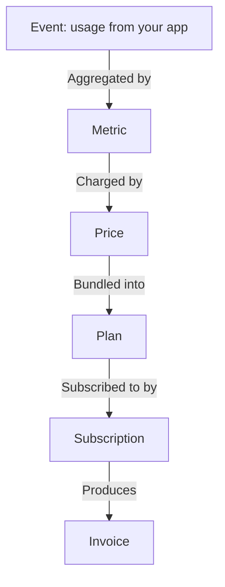

Orvlin separates what your product does (events) from what you charge for it (prices and plans). That separation lets you change pricing without changing your instrumentation.

## Customers

A customer is the party you bill. Each customer has an ID (yours or Orvlin's), a name, an optional billing email, a currency, and free-form `metadata`. Every other object refers to a customer by ID.

Set `id` to your own identifier when you create a customer. Then you never have to store a mapping between the two systems.

## Events

An event records something a customer did: an API call, a generated image, a row written. Each event has:

- `customerId`: who did it.
- `eventName`: what happened, such as `api_call`.
- `timestamp`: when it happened. Defaults to the time of ingestion.
- `properties`: details a metric can aggregate, such as `latencyMs` or `tokens`.
- `idempotencyKey`: optional. Events with the same key are counted once.

Events are the only input to metering. See [Usage metering](/guides/usage-metering).

## Metrics

A metric turns events into a number per billing period. The aggregation types are:

| Type | Result |
|---|---|
| `count` | Number of matching events. |
| `sum` | Sum of a numeric `property`. |
| `max` | Largest value of a numeric `property` in the period. |
| `count_distinct` | Number of distinct values of a `property`, such as unique users. |
| `sql` | A custom SQL expression over events, for advanced cases. |

Metrics can filter events and group them by a property.

## Prices

A price charges for a metric (or for a flat fee, when it has no metric). Each price has:

- a `config` with a pricing `model` (unit, tiered, bulk, package, percentage, or license). See [Pricing models](/pricing-models).
- a `cadence`: `monthly`, `quarterly`, `annual`, `one_time`, or `usage_based`.
- a `timing`: `in_advance` (charged at the start of the period) or `in_arrears` (charged at the end).

## Plans

A plan is a named bundle of prices. Customers subscribe to plans, not to individual prices. Editing a plan creates a new version, so existing subscriptions keep the terms they signed up for until you migrate them.

## Subscriptions

A subscription connects a customer to a plan from a start date. Its `status` is one of `active`, `trialing`, `past_due`, `paused`, or `canceled`.

You can cancel a subscription immediately or at the end of the period, amend it, schedule an amendment, or migrate it to a newer plan version.

## Invoices

Orvlin creates invoices for each billing period, for prepaid credit purchases, and for manual charges. An invoice moves through these statuses:

| Status | Meaning |
|---|---|
| `draft` | Created but not finalized. Can be approved or edited. |
| `open` | Finalized and waiting for payment. |
| `paid` | Payment received. |
| `void` | Cancelled. It cannot be paid. |
| `uncollectible` | Written off after payment attempts failed. |

## Credits and wallets

Credits are a prepaid balance a customer spends as they use your product. Each credit type (for example `ai_images`) has its own wallet per customer. Usage can draw down a wallet automatically, and a wallet can top itself up when it falls below a threshold. See [Prepaid credits](/guides/prepaid-credits).

## Entitlements

An entitlement answers "may this customer use this feature right now, and how much is left?" It is derived from the customer's subscription, plan, credits, and any grants you have added. See [Entitlements](/guides/entitlements).

## Webhooks

Webhooks deliver events such as `invoice.paid` and `subscription.created` to an HTTPS endpoint you own, with a signature you can verify. See [Webhooks](/api-reference/webhooks).

## Next steps

<CardGroup cols={2}>
  <Card title="Pricing models" icon="tags" href="/pricing-models">
    Unit, tiered, bulk, package, percentage, and license pricing.
  </Card>
  <Card title="Pricing as code" icon="file-code" href="/pricing-manifest">
    Declare your catalog in a `pricing.yaml` file.
  </Card>
</CardGroup>
