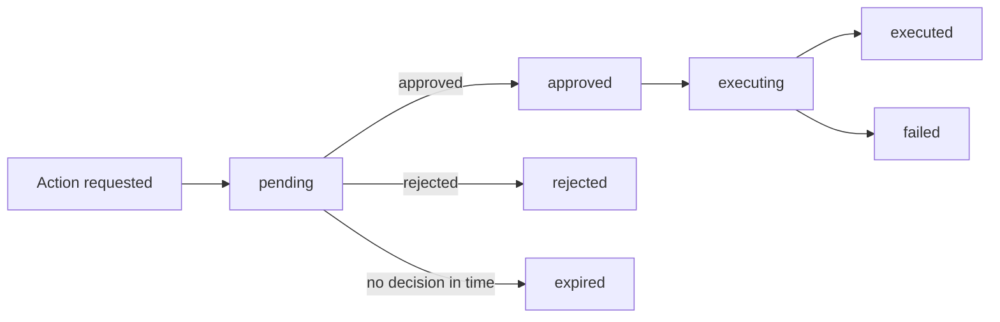

Approvals add a review step ("four eyes") before actions that move money. When a policy applies, the action waits for an approver instead of running right away.

## Which actions can require approval

| Action | What it does |
|---|---|
| `credit.grant` | Grants credits to a customer. |
| `invoice.void` | Voids an invoice. |
| `invoice.credit_note` | Issues a credit note. |
| `subscription.cancel` | Cancels a subscription. |

## Policies

Each action has a policy with three settings:

| Field | Type | Description |
|---|---|---|
| `enabled` | boolean | Whether this action needs approval. |
| `thresholdAmount` | number or `null` | Only amounts at or above this need approval. `null` means every amount does. |
| `thresholdCurrency` | string or `null` | The currency the threshold applies to, as a three-letter ISO code. |

Only workspace admins can change policies. Policies are read with `GET /v1/approvals/policies`, and updated with `PUT /v1/approvals/policies/:action`.

### Example: approve any credit grant over $500

```bash
curl -s -X PUT "$ORVLIN_API/v1/approvals/policies/credit.grant" \
  -H "Authorization: Bearer $ADMIN_SESSION_TOKEN" \
  -H "Content-Type: application/json" \
  -d '{ "enabled": true, "thresholdAmount": 500, "thresholdCurrency": "USD" }'
```

## Request lifecycle

When an action that needs approval is requested, Orvlin creates an approval request instead of running it.



| Status | Meaning |
|---|---|
| `pending` | Waiting for a decision. |
| `approved` | Approved. The action is about to run. |
| `executing` | The action is running. |
| `executed` | The action completed. |
| `failed` | The action was approved but couldn't complete. Check the error and retry. |
| `rejected` | Declined. The action does not run. |
| `expired` | No decision was made in time. The action does not run. |

## Working with requests

- List requests: `GET /v1/approvals`.
- Read one: `GET /v1/approvals/:id`.
- Approve: `POST /v1/approvals/:id/approve` with an optional `note`.
- Reject: `POST /v1/approvals/:id/reject` with an optional `note`.

Every decision is recorded in the [audit log](/enterprise/audit-logs), with the approver and the note. Orvlin also sends webhooks for approval events, so your team can route requests to Slack or a ticketing system.

<Tip>
Start with `thresholdAmount` set to a value that catches only the risky cases. Review the queue for a week before you tighten it.
</Tip>

## Related

- [API reference: approvals](/api-reference/approvals)
- [Audit logs](/enterprise/audit-logs)
