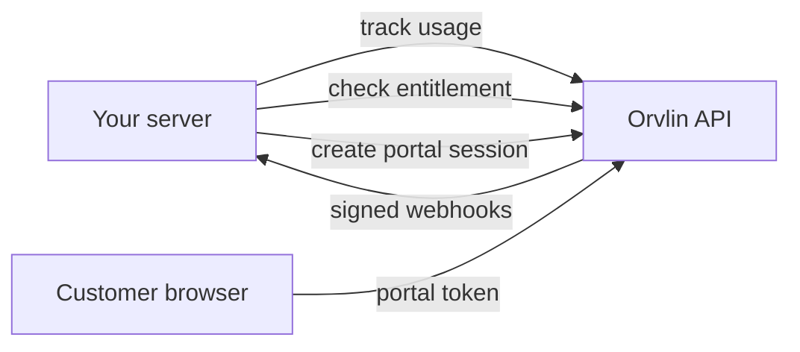

This guide takes an existing application from no billing to full integration. Each step builds on the one before, and each step has a check you can run before moving on.

<Info>
**Time:** 1–2 hours for a typical server · **You need:** a sandbox workspace, a `developer` API key, and a server application (Node.js or Python).
</Info>

## How the pieces fit



| Piece | Where it runs | Credential |
|---|---|---|
| Usage tracking and entitlement checks | Your server | API key |
| Webhooks | Your server (receives calls) | Webhook secret |
| Customer portal | Browser, with a session your server creates | Portal token |

Never put the API key in a browser or mobile app.

---

## Step 1: Map your product to billing terms

Before writing code, decide what you charge for. Write down three things:

1. **The billable action**, such as an API call, an image generated, or a seat used. This becomes an `eventName`.
2. **What you count**, such as the number of calls, or the sum of tokens. This becomes a [metric](/api-reference/metrics).
3. **How you charge**, such as per unit, in tiers, or by credits. This becomes a [price](/pricing-models).

<Check>
You can state your billable action in one sentence, for example: "Every successful search request is one `search_request` event."
</Check>

---

## Step 2: Create the catalog

Create the metric, price, and plan in your sandbox workspace. The [Meter your first API](/tutorials/meter-your-first-api) tutorial shows each call. You can also keep the catalog in a `pricing.yaml` file and deploy it with the [CLI](/sdks/cli).

<Check>
`GET /v1/plans` returns your plan, and the plan lists the price you created.
</Check>

---

## Step 3: Store your credentials

Create one API key per environment, with the smallest role that works. See [API keys](/api-reference/api-keys#roles).

| Environment | Workspace | Key role |
|---|---|---|
| Local development | Sandbox | `developer` |
| Staging | Sandbox | `developer` |
| Production | Live | `developer` (and `viewer` if a service only checks access) |

Add the key to your secret manager, then expose it to your server as environment variables:

```bash
ORVLIN_API_URL=https://api.orvlin.com
ORVLIN_API_KEY=orv_xxxxxxxx_your_secret
```

Never commit these values, and never log them.

<Check>
Run `curl -s -o /dev/null -w "%{http_code}" "$ORVLIN_API_URL/v1/health"`. It returns `200`.
</Check>

---

## Step 4: Install the SDK

<CodeGroup>

```bash Node.js
npm install @orvlin/node
```

```bash Python
pip install orvlin
```

</CodeGroup>

For a browser app, also install the React SDK with `npm install @orvlin/react`. It uses portal tokens, not API keys. See Step 9.

---

## Step 5: Create one client per process

Create the client once at startup and reuse it. The client caches entitlement answers, so reusing it keeps checks fast.

<CodeGroup>

```ts Node.js
// orvlin.ts
import { Orvlin } from '@orvlin/node';

export const orvlin = new Orvlin({
  apiKey: process.env.ORVLIN_API_KEY!,
  baseUrl: process.env.ORVLIN_API_URL,
  cacheTtlMs: 30_000,
  timeoutMs: 2_000,
  onUnavailable: 'deny',
});
```

```python Python
# orvlin_client.py
import os
from orvlin import Orvlin

orvlin = Orvlin(
    api_key=os.environ["ORVLIN_API_KEY"],
    base_url=os.environ["ORVLIN_API_URL"],
    cache_ttl=30.0,
    timeout=2.0,
    on_unavailable="deny",
)
```

</CodeGroup>

<Check>
Import the client in one route and call `orvlin.check("cust_test", "search_requests")`. It returns an answer without throwing. A `source` value of `live` shows the first call reached Orvlin.
</Check>

---

## Step 6: Connect customers

Each customer in your app needs a matching Orvlin customer. Use your own user or account ID as the Orvlin customer ID, so you never store a mapping.

<CodeGroup>

```bash curl
curl -s -X POST "$ORVLIN_API_URL/v1/customers" \
  -H "Authorization: Bearer $ORVLIN_API_KEY" \
  -H "Content-Type: application/json" \
  -d '{ "id": "acct_4821", "name": "Acme Corp", "email": "billing@acme.example" }'
```

</CodeGroup>

Create the customer when they sign up, and subscribe them to a plan at the same time:

```bash
curl -s -X POST "$ORVLIN_API_URL/v1/subscriptions" \
  -H "Authorization: Bearer $ORVLIN_API_KEY" \
  -H "Content-Type: application/json" \
  -d '{ "customerId": "acct_4821", "planId": "<plan id>" }'
```

<Check>
`GET /v1/customers/acct_4821` returns the customer, and the subscription has `"status": "active"` or `"trialing"`.
</Check>

---

## Step 7: Track usage

Record one event per billable action, after the action succeeds. Key each event to the request, so retries don't count twice.

<CodeGroup>

```ts Node.js
import { orvlin } from './orvlin';

export async function afterSearch(customerId: string, requestId: string) {
  await orvlin.track({
    customerId,
    eventName: 'search_request',
    idempotencyKey: requestId,
    properties: { statusCode: 200 },
  });
}
```

```python Python
from orvlin_client import orvlin

def after_search(customer_id: str, request_id: str) -> None:
    orvlin.track({
        "customer_id": customer_id,
        "event_name": "search_request",
        "idempotency_key": request_id,
        "properties": {"status_code": 200},
    })
```

</CodeGroup>

<Warning>
The `eventName` must match the event your metric counts. Check it against the metric definition in Step 2. A mismatch records usage that is never billed.
</Warning>

<Check>
`GET /v1/events?customer_id=acct_4821&event_name=search_request` lists the event. Sending it again with the same `idempotencyKey` does not add a second one.
</Check>

---

## Step 8: Gate features and spend

Before doing paid work, check the entitlement. Return a clear response when the customer is out of allowance.

<CodeGroup>

```ts Node.js
const check = await orvlin.check(customerId, 'search_requests', { amount: 1 });
if (!check.hasAccess) {
  return res.status(402).json({ error: 'Allowance used up', upgradeUrl: '/billing' });
}
```

```python Python
check = orvlin.check(customer_id, "search_requests", amount=1)
if not check.has_access:
    return Response({"error": "Allowance used up", "upgrade_url": "/billing"}, status=402)
```

</CodeGroup>

For prepaid credits, check the balance the same way with `checkCredits` (Node) or `check_credits` (Python), using `creditType` and `quantity`. See [Prepaid credits](/guides/prepaid-credits).

<Check>
A customer with allowance gets through. A customer without it gets `402`. See the [entitlements tutorial](/tutorials/gate-features-with-entitlements) for the full middleware.
</Check>

---

## Step 9: Receive webhooks

Webhooks tell your app when an invoice is paid, a subscription changes, or an approval is decided. Register an HTTPS endpoint, then verify every delivery before you act on it.

Register the endpoint with a signed-in user session (not an API key):

```bash
curl -s -X POST "$ORVLIN_API_URL/v1/webhooks" \
  -H "Authorization: Bearer $USER_SESSION_TOKEN" \
  -H "Content-Type: application/json" \
  -d '{ "url": "https://app.acme.example/webhooks/orvlin", "events": ["invoice.paid", "subscription.plan_change"] }'
```

Save the `secret` (it starts with `whsec_`) in your secret manager. Verify each delivery as shown in [Webhooks](/api-reference/webhooks#verify-signatures). Then handle each event once, keyed on its `id`. The [Receive webhooks securely](/tutorials/receive-webhooks-securely) tutorial builds this end to end.

<Check>
`POST /v1/webhooks/:id/test` delivers a test event, and your endpoint returns `200`.
</Check>

---

## Step 10: Add a customer portal (optional)

If customers should see their usage, invoices, and plans in your app, create a portal session from your server, and use the React SDK in the browser.

Your server creates the session for the signed-in user's customer only:

```bash
curl -s -X POST "$ORVLIN_API_URL/v1/portal/sessions" \
  -H "Authorization: Bearer $ORVLIN_API_KEY" \
  -H "Content-Type: application/json" \
  -d '{ "customerId": "acct_4821", "expiresInSeconds": 900, "allowPlanChanges": true }'
```

The browser then uses the React SDK with that token. See [Launch a customer portal](/tutorials/launch-customer-portal).

<Check>
The portal endpoint `GET /v1/portal/me` returns the customer when called with the portal token.
</Check>

---

## Go-live checklist

- [ ] Sandbox tests pass for tracking, gating, and webhooks.
- [ ] A test clock shows the expected first invoice ([tutorial](/tutorials/test-billing-with-test-clocks)).
- [ ] Production uses a live workspace and its own API key, stored in your secret manager.
- [ ] Webhook endpoint uses HTTPS and verifies signatures.
- [ ] Every event and grant uses an idempotency key.
- [ ] Entitlement checks log the `source` field, so you can see fallbacks.
- [ ] Your team knows where the [audit log](/enterprise/audit-logs) is and who can approve money-moving actions ([approvals](/enterprise/approvals)).

## Troubleshooting

| Symptom | Likely cause | Fix |
|---|---|---|
| `401 Unauthorized` | Key missing, mistyped, or revoked. | Check the environment variable. Create a new key if this one was revoked. |
| `403 Forbidden` | The key's role can't do this action. | Use a key with a higher role, such as `developer` for tracking. |
| `404 Not Found` on a customer or plan | The ID doesn't exist in this workspace. | Check you're using the sandbox or live key that matches the ID. |
| Usage recorded but not billed | The `eventName` doesn't match the metric. | Compare the event name with the metric definition. |
| Every check returns `fallback` | Orvlin isn't reachable from your network. | Check outbound HTTPS to `api.orvlin.com`, and the timeout setting. |
| Webhooks not arriving | Endpoint returns non-`2xx`, or isn't HTTPS. | Check the [delivery log](/api-reference/webhooks#manage-endpoints) and fix the endpoint. |

## Next steps

<CardGroup cols={2}>
  <Card title="Meter your first API" icon="gauge" href="/tutorials/meter-your-first-api">
    Build the catalog and first usage record end to end.
  </Card>
  <Card title="Reliability" icon="shield" href="/enterprise/reliability">
    What happens during failures, and what your systems should do.
  </Card>
</CardGroup>
