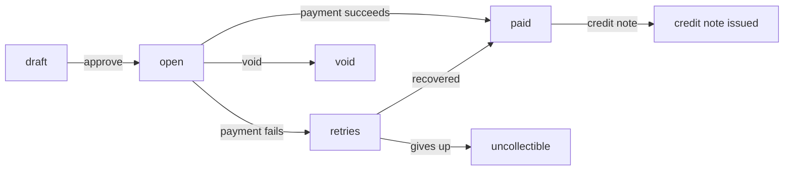

Orvlin turns subscriptions and usage into invoices, collects payment through your payment provider, and retries failed charges. This guide covers the lifecycle and the actions you can take at each step.

## The invoice lifecycle

Invoices that need review wait as `draft` until someone approves them. Others are finalized as `open` when they are issued.

## Approve, pay, and void

| Action | Endpoint | Notes |
|---|---|---|
| Approve a draft | `POST /v1/invoices/:id/approve` | Moves the invoice to `open`. |
| Charge now | `POST /v1/invoices/:id/pay` | Charges the card on file. Fails for `paid` or `void` invoices. |
| Void | `POST /v1/invoices/:id/void` | Cancels the invoice. A voided invoice cannot be paid. |
| Credit | `POST /v1/invoices/:id/credit-note` | Issues a credit note against a paid invoice. |
| Send a link | `GET /v1/invoices/:id/link` | A hosted page where the customer can pay. |
| Download | `GET /v1/invoices/:id/pdf` | The invoice as a PDF. |

## Payment retries

When a charge fails, Orvlin retries it on a schedule. Configure the schedule with the payment retry endpoints (`/v1/payment-retry/settings`) or in the dashboard. Each attempt is recorded at `GET /v1/invoices/:id/payment-attempts`.

Webhooks tell you what happened:

- `invoice.payment_failed`: a charge failed.
- `invoice.payment_action_required`: the customer must act, such as confirming a card.
- `invoice.payment_recovered`: a retry succeeded.
- `invoice.marked_uncollectible`: retries are exhausted.

## Connect a payment provider

Orvlin charges cards through your own Stripe account. Connect it from the dashboard's payment settings using the Stripe OAuth flow. Stripe sends its webhooks to Orvlin at `/v1/payments/webhooks`.

Each workspace connects its own Stripe account, so payouts go directly to you.

<Warning>
Sandbox workspaces never reach a real payment processor, whatever the configuration. Use sandbox to test the flow end to end, then switch to a live workspace when you are ready to charge customers.
</Warning>

## Tax

Orvlin can calculate tax through Avalara or Anrok. Customers need a country on their billing address before tax can be calculated; customers without one are skipped with a warning rather than taxed in the wrong place. See [Integrations](/guides/integrations#tax).

## Revenue recognition

Orvlin can schedule recognition of invoice revenue over the service period (ASC 606). Generate schedules with `POST /v1/revenue/generate`, then read `GET /v1/revenue/summary`, `GET /v1/revenue/waterfall`, and `GET /v1/revenue/contracts`.

## Accounting periods

Lock a month once its books are closed so invoices in that period cannot change. Use `POST /v1/accounting/periods/:month/:year/lock` and the matching `unlock` endpoint.
