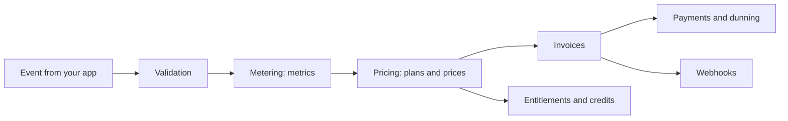

Orvlin is a pipeline. Your application produces events, Orvlin turns them into billable quantities, applies your prices, and produces the invoices, entitlements, and notifications that follow. Each step has rules you can rely on.

## 1. Events are validated on arrival

Each event is checked before it's stored:

- `eventName` and `customerId` are required.
- The customer must exist in your workspace. An event for an unknown customer is rejected, because it could never be billed.
- Timestamps must be valid, and not too far in the past. Older events must be sent to the [backfill endpoint](/backfill-and-rerate).
- Events dated in a closed [accounting period](/enterprise/accounting-periods) are rejected.

Rejected events are returned in the `rejected` list with a reason and a code, so your application can fix and resend them.

## 2. Duplicates are counted once

An event with an `idempotencyKey` that has already been stored is not counted again. This is what makes retries safe. See [Usage metering](/guides/usage-metering).

## 3. Metrics aggregate events

Metrics turn stored events into billable numbers for each billing period: counts, sums, maximums, distinct counts, or custom SQL. Metrics are computed from events, so the same events always give the same numbers. See [Metrics](/api-reference/metrics).

## 4. Prices and plans set the amount

Each price applies a pricing model to a metric, or charges a flat fee. Plans bundle prices, and subscriptions attach a customer to a plan from a start date. Changing a plan creates a new version, so existing subscriptions keep their terms until they are migrated. See [Pricing models](/pricing-models) and [Price changes](/price-changes).

## 5. Invoices are issued

At the end of each billing period, Orvlin issues an invoice for each subscription. Invoices move through `draft`, `open`, `paid`, `void`, and `uncollectible`. Invoices that need review wait as `draft` until approved. See [Invoicing and collection](/guides/invoicing-and-collection).

## 6. Entitlements answer in real time

Entitlements are computed from the same plans, grants, and consumption, and cached in the SDKs so checks in your request path stay fast. See [Entitlements](/guides/entitlements).

## 7. Payments, dunning, and webhooks follow

Failed charges are retried and customers are reminded according to your [collections](/collections) settings. Every state change, such as `invoice.paid` or `subscription.plan_change`, is sent to your webhook endpoints, signed, and retried with increasing delays for about a day if your endpoint doesn't acknowledge it. See [Webhooks](/api-reference/webhooks).

## What this means for your integration

- Send events as they happen, and always include an idempotency key.
- Check entitlements before doing paid work, and record usage after it succeeds.
- Treat the webhook as the source of truth for payment state, not your own payment attempt.
