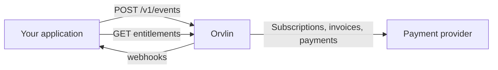

Orvlin is a hosted billing platform for SaaS and AI products. It meters the usage your product generates, turns it into prices and plans, checks what each customer is entitled to, and produces the invoices and payments that follow.

You send Orvlin events from your application. Orvlin aggregates them into metrics, applies your prices and plans, and handles subscriptions, credits, invoicing, and collection. Your application asks Orvlin whether a customer can use a feature before it does the work.

## What you can build with it

<CardGroup cols={2}>
  <Card title="Usage-based billing" icon="gauge" href="/guides/usage-metering">
    Meter API calls, tokens, seats, or any custom event, and bill for consumption.
  </Card>
  <Card title="Entitlements" icon="shield-check" href="/guides/entitlements">
    Gate features and enforce limits in your request path with a local cache.
  </Card>
  <Card title="Prepaid credits" icon="coins" href="/guides/prepaid-credits">
    Sell credit packs, grant credits, and top up automatically when balances run low.
  </Card>
  <Card title="Invoicing and collection" icon="file-invoice-dollar" href="/guides/invoicing-and-collection">
    Issue invoices, collect payment, retry failed charges, and void or credit as needed.
  </Card>
</CardGroup>

## How it fits together

## Where to go next

<CardGroup cols={3}>
  <Card title="Quickstart" icon="rocket" href="/quickstart">
    Create a customer, define a price, and send your first event in a few minutes.
  </Card>
  <Card title="Core concepts" icon="layer-group" href="/core-concepts">
    Learn the objects: events, metrics, prices, plans, subscriptions, and invoices.
  </Card>
  <Card title="API reference" icon="code" href="/api-reference/overview">
    Every endpoint, with request and response fields.
  </Card>
</CardGroup>

<Note>
Start in a sandbox workspace. Sandbox payments never reach a real payment processor, so you can test invoices and collection safely.
</Note>
